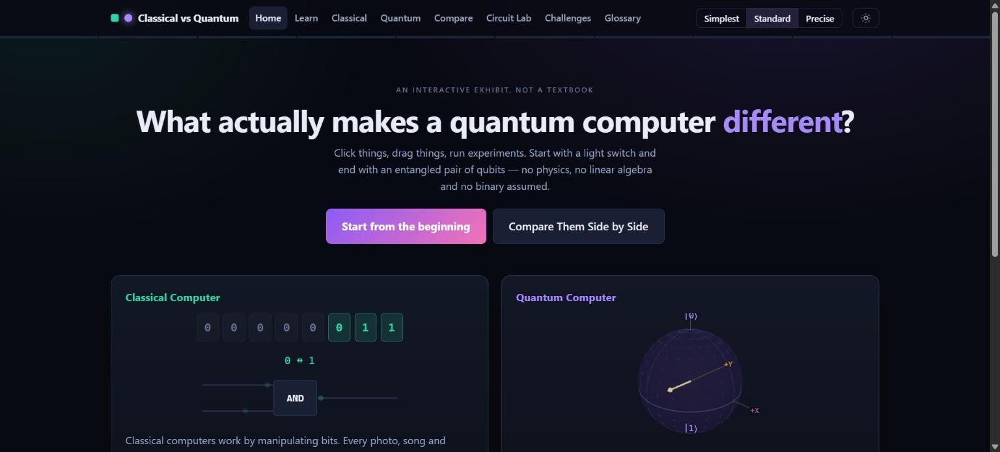
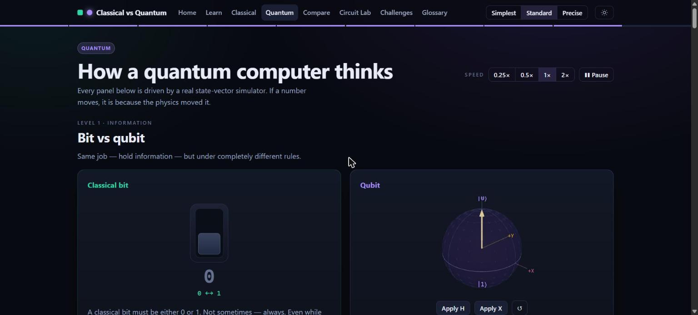
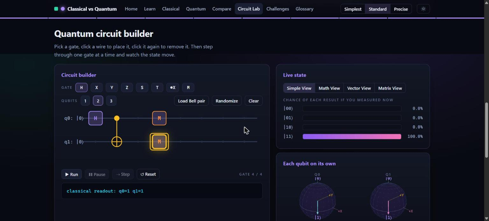

# Classical vs Quantum — Interactive Simulator

**Deployment-build backup.** An interactive, in-browser exhibit that explains how classical and quantum
computers represent and process information, from a light switch to an entangled pair of qubits.

**Live demo:** <https://aabinmuqbil.github.io/Classical-VS-Quantum/#/>

> **This repository is a backup of the deployed build, not the original development source code.**
> It holds a byte-identical copy of the minified build that was served at the live demo on 2026-11-23.
> The original source code and development history were not available when this backup was made.
> Nothing was reconstructed, no source files were invented, and no commits from the original project are
> included or implied. The single commit here is labelled as a deployment-build backup.



## Features

Observed by running this exact snapshot in a browser on 2026-11-23:

- **Guided path.** The *Learn* page lays out eight levels (information, states, operations, multiple units,
  relationships, getting answers, algorithms, real problems) and tracks 10 concepts and 15 challenges.
  Progress is kept in the browser's `localStorage`.
- **Classical side.** A clickable bit, an *n*-bit counter showing the 2ⁿ possible combinations, a logic-gate
  bench (NOT, AND, OR, XOR, NAND, NOR) with truth tables, and a step-through circuit simulator (inverter,
  AND, half adder, selector).
- **Quantum side.** A draggable Bloch sphere; X, H, Z, Y, S and T gates; a repeated-measurement experiment
  (1 to 1,000 shots); phase and interference demos; a multi-qubit explorer; and a Bell-pair (entanglement)
  workshop. The page states that its panels are driven by a state-vector simulator.
- **Circuit Lab.** A designer for custom single-qubit gates, a 1–3 qubit circuit builder (H, X, Y, Z, S, T,
  CNOT, measure) with Run and Step, and live-state views (simple, math, vector, matrix). Loading the Bell
  pair and running it gave correlated measurements (`q0=1 q1=1`).
- **Compare page.** Classical search versus a Grover-style search over 16 boxes, a Shor-style
  period-finding walkthrough, CPU / GPU / QPU roles, a decoherence-noise slider, an error-correction
  illustration and myth-versus-reality cards.
- **Reading levels and theme.** A global Simplest / Standard / Precise switch, per-panel *Explain Simpler*
  and *What's Really Happening?* buttons, animation speed and pause controls, a light/dark theme toggle
  (checked: it switches the page theme), and a 20-term glossary.





## Technologies identified from the deployed build

| Area | Identified |
|---|---|
| UI | React 19.2.8 |
| Routing | React Router 7.18.2 with hash routes (`#/learn`, `#/lab`, …) |
| 3D | three.js r185 through @react-three/fiber 9.7.0 (lazy-loaded Bloch-sphere scene) |
| Animation | framer-motion |
| Build | Vite-style ES-module bundle: hashed `assets/` files and per-route code splitting |
| Hosting | Static site on GitHub Pages; no backend and no API calls |
| Security | Strict Content-Security-Policy declared in `index.html` |
| Storage | Browser `localStorage` (key `quantum-analogy-progress`) |

These come from the minified files only; versions are the ones embedded in the bundles.

## Run this backup locally

Needs Python 3 (any static file server works):

```bash
git clone https://github.com/I9797l/classical-vs-quantum.git
cd classical-vs-quantum
python -m http.server 8000 --directory site
```

Open <http://127.0.0.1:8000/Classical-VS-Quantum/>. The app must be served under the
`/Classical-VS-Quantum/` path, which the folder layout under `site/` provides. It uses hash routes, so no
server rewrite rules are needed.

## Repository contents

| Path | What it is |
|---|---|
| `site/Classical-VS-Quantum/` | The 22 deployed files, exactly as served (HTML, JavaScript chunks, CSS). |
| `SHA256SUMS.txt` | SHA-256 of every file under `site/`. Check with `sha256sum -c SHA256SUMS.txt`. |
| `DEPLOYMENT-SNAPSHOT-NOT-SOURCE.md` | Provenance notes for the snapshot. |
| `NOTICE.md` | Copyright, license and attribution notices. |
| `docs/screenshots/` | Screenshots captured from this unmodified snapshot running locally. |
| `.gitattributes` | Disables line-ending conversion so the files stay byte-identical on every OS. |

Everything under `site/` is unmodified.

## What is not included

The original TypeScript/JSX source, comments and file names, `package.json` and lockfile, build
configuration, the deployment workflow, tests, documentation, and the project's git history and
authorship. None of that can be recovered from a deployed build.

## About this repository

Maintained by [@I9797l](https://github.com/I9797l) as a personal, verbatim backup of the deployed build
(prepared 2026-11-23). It makes no claim about who built the app beyond the credits declared in the build,
which are reproduced below.

## Copyright and license attribution

The deployed site declares:

> Code: MIT. Educational content: CC BY-NC-SA 4.0. © 2026 Abdullah Bin Muqbil.

That notice is preserved unmodified in the shipped files (`site/Classical-VS-Quantum/index.html`, as a
`<meta name="license">` tag, and in the app's own text inside `assets/index--7xtfBEn.js`). Copyright
remains with the original author. The full attribution, the MIT License text and the CC BY-NC-SA terms are
in [`NOTICE.md`](NOTICE.md). This repository adds no license of its own. Please respect the NonCommercial
and ShareAlike terms that apply to the educational content.
